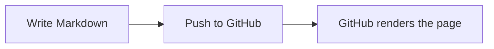

# GitHub Repository Showcase

An end-to-end example of a GitHub repository: its About details, community
files, issues, pull requests, Actions workflow, and Pages site. It also includes
common `git` and `gh` CLI commands and a catalog of GitHub Markdown features.

## Contents

- [Everyday Git and GitHub CLI](#everyday-git-and-github-cli)
- [Repository settings and this setup](#repository-settings-and-this-setup)
- [GitHub Markdown features](#github-markdown-features)
- [Text and headings](#text-and-headings)
- [Links and references](#links-and-references)
- [Images and badges](#images-and-badges)
- [Lists and task lists](#lists-and-task-lists)
- [Tables](#tables)
- [Code](#code)
- [Quotes and alerts](#quotes-and-alerts)
- [Collapsible sections and HTML](#collapsible-sections-and-html)
- [GitHub references and emoji](#github-references-and-emoji)
- [Footnotes](#footnotes)
- [Math](#math)
- [Mermaid diagrams](#mermaid-diagrams)
- [Repository community files](#repository-community-files)
- [Issues, pull requests, and deployment](#issues-pull-requests-and-deployment)
- [Writing tips](#writing-tips)

## Everyday Git and GitHub CLI

### Git

These commands cover the usual local change cycle:

```sh
git clone https://github.com/OWNER/REPOSITORY.git
cd REPOSITORY
git status
git switch -c docs/my-change
git diff
git add README.md
git commit -m "docs: describe the change"
git push -u origin docs/my-change
git pull --ff-only
git log --oneline --graph --decorate --all
```

Use `git diff --staged` to review staged changes before committing. Use
`git switch main` to return to the default branch and `git fetch origin` to
refresh remote-tracking branches without changing the current branch.

### GitHub CLI

Authenticate once with `gh auth login`, then use `gh` to work with GitHub from
the terminal:

```sh
gh auth status
gh repo view OWNER/REPOSITORY
gh issue list --repo OWNER/REPOSITORY
gh pr list --repo OWNER/REPOSITORY
gh workflow list --repo OWNER/REPOSITORY
gh run list --repo OWNER/REPOSITORY
gh release list --repo OWNER/REPOSITORY
```

Use `gh pr checks NUMBER` to inspect pull-request checks and
`gh run view RUN_ID --log` to inspect a workflow run.

## Repository settings and this setup

The repository **About** panel is edited with the gear beside the panel. It
contains the description, website URL, topics, and homepage display options for
Releases, Deployments, and Packages. The first three can also be set with `gh`:

```sh
gh repo edit OWNER/REPOSITORY \
	--description "A concise description" \
	--homepage "https://example.github.io/REPOSITORY/" \
	--add-topic documentation \
	--add-topic github-actions
```

`--add-topic` adds topics without replacing the existing set;
`--remove-topic` removes one. To replace all topics, use the GitHub UI or the
`PUT /repos/{owner}/{repo}/topics` REST endpoint. In the UI, use the About gear
to change the description, website, and topics. The **Include in the home
page** checkboxes for Releases, Deployments, and Packages are separate UI
settings.

This repository was configured with the same CLI flow:

```sh
gh repo edit dev-ansung/Template \
	--description "A practical showcase of GitHub Markdown, repository workflows, community files, and deployment." \
	--homepage "https://dev-ansung.github.io/Template/" \
	--add-topic documentation \
	--add-topic github-actions \
	--add-topic github-markdown \
	--add-topic github-pages \
	--add-topic github-cli \
	--add-topic git \
	--add-topic markdown
```

The repository was made public using **Settings** > **General** > **Change
repository visibility**. Visibility changes are consequential; verify the
contents and secrets before making a repository public. With GitHub CLI, the
equivalent command requires an explicit confirmation flag:

```sh
gh repo edit OWNER/REPOSITORY --visibility public --accept-visibility-change-consequences
```

The repository's current visibility can be checked with
`gh repo view OWNER/REPOSITORY`.

### How the demo issue and pull request were created

Create an issue first so it has a real number to reference. Then create a branch
and open a pull request that closes the issue when merged:

```sh
gh issue create --repo OWNER/REPOSITORY --title "Describe the change" --body "Explain the goal and acceptance criteria."
git switch -c docs/my-change
git add README.md
git commit -m "docs: describe the change"
git push -u origin docs/my-change
gh pr create --repo OWNER/REPOSITORY --base main --head docs/my-change --title "docs: describe the change" --body "Closes #ISSUE_NUMBER"
```

For this showcase, [issue #1](https://github.com/dev-ansung/Template/issues/1)
was created with `gh issue create`. [Pull request #2](https://github.com/dev-ansung/Template/pull/2)
was opened from a feature branch with `gh pr create` and `Closes #1`, then
squash-merged with `gh pr merge 2 --squash --delete-branch`. GitHub closed the
issue automatically after the merge.

## GitHub Markdown features

The sections below demonstrate Markdown as one feature of this repository.

## Text and headings

Use one `#` for the document title, then increase the number of `#` characters
for nested sections.

### Heading level 3

#### Heading level 4

##### Heading level 5

###### Heading level 6

Paragraphs are separated by a blank line. You can use **bold**, *italic*,
***bold and italic***, ~~strikethrough~~, and `inline code` in text.

To show Markdown characters literally, escape them with a backslash: `\*not italic\*`.

## Links and references

- [A descriptive link](https://docs.github.com/en/get-started/writing-on-github)
- [A link to another file in this repository](CONTRIBUTING.md)
- [A link to a heading](#tables)
- <https://github.com> and <hello@example.com> are autolinked.

Reference-style links are useful when the same destination appears more than once:

Read the [GitHub Markdown documentation][markdown-docs]. You can also visit
[the documentation site][markdown-docs] later in this paragraph.

[markdown-docs]: https://docs.github.com/en/get-started/writing-on-github

## Images and badges

### Image sources and formats

GitHub renders images through Markdown and a sanitized subset of HTML. Use
descriptive alt text, keep repository assets in version control, and use a
relative path for files in the same repository. Common examples include PNG or
JPEG screenshots, animated GIFs, and SVG badges:

```markdown


```

To make an image clickable, wrap it in a link. HTML is useful when you need to
set a stable width or alignment:

```markdown
[](https://github.com/dev-ansung/Template)
```

<p align="center">
  
</p>

GitHub also accepts images pasted or uploaded into issues, pull requests, and
discussions, then inserts an attachment URL. Avoid relying on arbitrary HTML
embeds; GitHub sanitizes HTML and does not allow scripts in Markdown.

### Live repository badges

Badges are images, commonly SVGs, that report status or link to more detail.
These examples use real data from this repository:

[](https://github.com/dev-ansung/Template/actions/workflows/pages.yml)
[](LICENSE)
[](https://github.com/dev-ansung/Template/stargazers)
[](https://github.com/dev-ansung/Template/forks)
[](https://github.com/dev-ansung/Template/issues)
[](https://github.com/dev-ansung/Template/pulls)
[](https://github.com/dev-ansung/Template/commits/main)
[](https://github.com/dev-ansung/Template/graphs/contributors)

This repository has no published release yet. Add a release badge when a
version is published, for example:

```markdown
[](https://github.com/OWNER/REPOSITORY/releases/latest)
```

### Package, coverage, and custom badges

For projects that publish packages or coverage reports, badge providers expose
different endpoints. Replace the placeholders with the real package or
repository identifiers and link each badge to its details page:

```markdown
[](https://codecov.io/gh/OWNER/REPOSITORY)
[](https://www.npmjs.com/package/PACKAGE)
[](https://www.npmjs.com/package/PACKAGE)
[](https://pypi.org/project/PACKAGE/)
[](https://pypi.org/project/PACKAGE/)
[](https://hub.docker.com/r/OWNER/IMAGE)
```

Static/custom labels can use Shields.io's badge endpoint:

```markdown

```

There is no finite list of badges supported by GitHub: a badge is an image URL
provided by GitHub or another service. Choose badges that report maintained,
useful information, and include alt text so their purpose remains clear if an
image fails to load.

## Lists and task lists

Unordered lists use `-`, `*`, or `+`:

- First item
- Second item
	- Nested item
	- Another nested item

Ordered lists use numbers:

1. Prepare the change
2. Run the checks
3. Open a pull request

Task lists render checkboxes. In issues and pull requests, eligible users can
click them to update the source:

- [x] Add a README title
- [x] Document common Markdown
- [ ] Review the rendered page

## Tables

Tables use pipes between cells and a separator row. Colons control alignment:

| Feature | Markdown | Alignment |
| :--- | :---: | ---: |
| Left | `:---` | Text |
| Center | `:---:` | Text |
| Right | `---:` | Text |

Escape a literal pipe inside a cell with `\|`. Tables can contain links,
emphasis, and inline code, but avoid putting complex block content in cells.

## Code

Use backticks for inline code, and fenced blocks for multiple lines. Add a
language identifier after the opening fence for syntax highlighting:

```javascript
function greet(name) {
	return `Hello, ${name}!`;
}
```

Indented code blocks are also supported, but fenced blocks are easier to read
and let GitHub choose syntax highlighting. To include a fence inside a code
sample, wrap it with a longer fence:

````markdown
```text
This inner fence is shown as text.
```
````

Diff fences highlight added and removed lines:

```diff
- Old behavior
+ New behavior
	Unchanged context
```

## Quotes and alerts

Start a line with `>` to create a blockquote. Prefix each paragraph or list line
with `>` to keep it inside the quote:

> A short quotation can call attention to a useful note.
>
> It can contain multiple paragraphs.

GitHub supports styled alert blocks in Markdown files, issues, and pull requests:

> [!NOTE]
> Use a note for helpful context that is not critical.

> [!TIP]
> Use a tip for a useful shortcut or recommendation.

> [!IMPORTANT]
> Use an important alert for information users need to know.

> [!WARNING]
> Use a warning when an action could cause problems.

> [!CAUTION]
> Use a caution for potentially negative consequences.

## Collapsible sections and HTML

GitHub allows a subset of HTML in Markdown. `<details>` and `<summary>` create
content that readers can expand:

<details>
<summary>Show the expanded content</summary>

This content is hidden until the summary is selected. Markdown can be used
inside the details block, including lists and code fences.

- One item
- Another item

</details>

Other useful inline HTML includes line breaks, keyboard keys, and subscript or
superscript text: First line<br />Second line; press <kbd>Ctrl</kbd>+<kbd>C</kbd>;
H<sub>2</sub>O; x<sup>2</sup>.

HTML support is sanitized for security. Scripts, styles, and arbitrary embeds
are not a reliable way to add content to a GitHub README.

## GitHub references and emoji

GitHub automatically links many repository references in supported contexts:

- Issue in another repository: github/docs#46475
- Issue in this repository: #1
- Pull request in this repository: [#2](https://github.com/dev-ansung/Template/pull/2)
- Commit in this repository: [3ee0556](https://github.com/dev-ansung/Template/commit/3ee0556f16f33a868e6856adf2556f265111ff3d)
- User profile: [@dev-ansung](https://github.com/dev-ansung)
- Emoji shortcodes: :sparkles: and :rocket:

Issue references are plain text and link when the referenced issue exists.
Commit hashes, user mentions, and pull request references may not auto-link in
a README, so explicit Markdown links are used for those examples. Issue #1 and
PR #2 are live examples; the PR closes the issue when merged.

## Footnotes

Footnotes add a compact source or aside without interrupting the paragraph.[^1]
You can also use a named marker more than once.[^note]

[^1]: Footnote definitions can contain links, such as [GitHub Docs](https://docs.github.com/).
[^note]: GitHub supports Markdown footnotes in Markdown files and comments.

## Math

GitHub renders LaTeX-style math with dollar delimiters. Inline math looks like
$E = mc^2$.

For a displayed equation, put the expression on its own lines:

$$
\sum_{i=1}^{n} i = \frac{n(n+1)}{2}
$$

## Mermaid diagrams

Use a `mermaid` fenced code block for flowcharts, sequence diagrams, timelines,
and other supported Mermaid diagram types:



## Repository community files

GitHub automatically adds repository navigation links for recognized community
files. These links are generated by GitHub; adding a Markdown link or button to
the README does not create them. Put the standard files at the repository root:

| Tab | Filename | Purpose |
| :--- | :--- | :--- |
| Contributing | [`CONTRIBUTING.md`](CONTRIBUTING.md) | Explain how to report issues and contribute changes. |
| Code of conduct | [`CODE_OF_CONDUCT.md`](CODE_OF_CONDUCT.md) | Set expectations for respectful participation. |
| License | [`LICENSE`](LICENSE) | State the terms under which others may use and distribute the work. |
| Security | [`SECURITY.md`](SECURITY.md) | Explain how to report vulnerabilities privately. |

To add a community file on GitHub, select **Add file** > **Create new file**,
enter the exact filename above, add its content, and commit it. You can also
create the file locally and push it. GitHub detects recognized files and adds
the corresponding repository link automatically.

Choose a license intentionally because it sets the terms for using and
redistributing the work. Compare options at [Choose a License](https://choosealicense.com/).
GitHub also offers a license template chooser when you create a root-level file
named `LICENSE`. The [Licenses REST API](https://docs.github.com/en/rest/licenses)
can retrieve a template; with GitHub CLI, for example, run
`gh api licenses/mit --jq .body`. This returns the template text, not a selected
or applied license, so replace placeholders such as `[year]` and `[fullname]`
before committing it.

For this repository, the selected MIT terms are in [`LICENSE`](LICENSE).

## Issues, pull requests, and deployment

### Create an issue and linked pull request

Enable **Issues** under **Settings** > **General** > **Features** if the
repository does not show an Issues tab. Create an issue from **Issues** >
**New issue**, or use GitHub CLI:

```sh
gh issue create --repo OWNER/REPOSITORY --title "Describe the change" --body "Explain the problem and expected result."
```

An issue number becomes a working reference such as `#1` once the issue exists.
Use issue forms or Markdown templates in `.github/ISSUE_TEMPLATE/` when a
project needs consistent reports.

For a change, create a branch, commit, and push it, then open a pull request:

```sh
git switch -c docs/my-change
git add README.md
git commit -m "docs: describe the change"
git push -u origin docs/my-change
gh pr create --base main --title "docs: describe the change" --body "Closes #1"
```

Replace `main` if the repository uses a different default branch. `Closes #1`
links the pull request to the issue and closes it when the PR is merged. Use
`Refs #1` when the PR is related but should not close the issue. A repository
can add a default PR checklist in `.github/PULL_REQUEST_TEMPLATE.md`.

### Publish this guide with GitHub Pages

This repository publishes the README through [`index.md`](index.md) and the
workflow in [`.github/workflows/pages.yml`](.github/workflows/pages.yml). Its
live site is [dev-ansung.github.io/Template](https://dev-ansung.github.io/Template/).
To publish a Pages site for another repository:

1. Open **Settings** > **Pages** and set **Build and deployment** > **Source**
	to **GitHub Actions**.
2. Push a change to `main`, or run the **Deploy GitHub Pages** workflow from
	the **Actions** tab. The workflow builds the Jekyll site and deploys it.
3. Open **Settings** > **Pages** to find the published URL, then check the
	workflow run if the site does not update.

Pages sites are publicly visible by default. This showcase's source repository
is public, Pages is configured to use GitHub Actions, and the URL above is live.
Private-source Pages availability depends on the GitHub plan. Do not make a
private repository public just to enable Pages without reviewing its contents
first.

### Deploy an application with GitHub Actions

For an application, add a workflow under `.github/workflows/` that builds and
tests on pull requests, then deploys only from the intended branch (usually the
default branch). Use a deployment action that matches the hosting provider, and
upload the build output as an artifact between jobs when needed. Keep workflow
permissions minimal, store credentials in **Settings** > **Secrets and
variables** (prefer environment secrets for production), and use a protected
GitHub Environment when approvals are required. Never put tokens or cloud
credentials in the repository or README. Review the workflow logs and deployed
URL after each release.

## Writing tips

- Use headings in order to give the document a clear outline.
- Add useful alt text to images, including badges and screenshots.
- Prefer descriptive link text over phrases such as “click here.”
- Use relative links for files in the same repository.
- Preview the rendered Markdown before merging, especially after adding HTML,
	tables, alerts, or diagrams.

For full syntax and current limitations, see [GitHub's Markdown guide](https://docs.github.com/en/get-started/writing-on-github).
