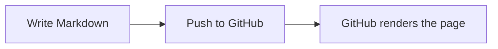

# GitHub Markdown Showcase

A hands-on reference for Markdown features supported by GitHub. The examples
below are intended to render as demonstrations, not just show source syntax.

## Contents

- [Text and headings](#text-and-headings)
- [Links and references](#links-and-references)
- [Images and badges](#images-and-badges)
- [Lists and task lists](#lists-and-task-lists)
- [Tables](#tables)
- [Code](#code)
- [Quotes and alerts](#quotes-and-alerts)
- [Collapsible sections and HTML](#collapsible-sections-and-html)
- [GitHub references and emoji](#github-references-and-emoji)
- [Footnotes](#footnotes)
- [Math](#math)
- [Mermaid diagrams](#mermaid-diagrams)
- [Repository community files](#repository-community-files)
- [Writing tips](#writing-tips)

## Text and headings

Use one `#` for the document title, then increase the number of `#` characters
for nested sections.

### Heading level 3

#### Heading level 4

##### Heading level 5

###### Heading level 6

Paragraphs are separated by a blank line. You can use **bold**, *italic*,
***bold and italic***, ~~strikethrough~~, and `inline code` in text.

To show Markdown characters literally, escape them with a backslash: `\*not italic\*`.

## Links and references

- [A descriptive link](https://docs.github.com/en/get-started/writing-on-github)
- [A link to another file in this repository](CONTRIBUTING.md)
- [A link to a heading](#tables)
- <https://github.com> and <hello@example.com> are autolinked.

Reference-style links are useful when the same destination appears more than once:

Read the [GitHub Markdown documentation][markdown-docs]. You can also visit
[the documentation site][markdown-docs] later in this paragraph.

[markdown-docs]: https://docs.github.com/en/get-started/writing-on-github

## Images and badges

Images use descriptive alt text. A linked image is a common pattern for badges:

[](https://docs.github.com/en/get-started/writing-on-github)

The same pattern can display build status, release versions, license, package
downloads, or community metrics. Prefer badges that link to the page with the
details, and give each image meaningful alt text.

An image can also be linked with HTML when you need to set its dimensions or
alignment:

<p align="center">
	
</p>

For repository images, use a relative path such as `docs/images/example.png`.
GitHub also supports images uploaded to issues, pull requests, and discussions.

## Lists and task lists

Unordered lists use `-`, `*`, or `+`:

- First item
- Second item
	- Nested item
	- Another nested item

Ordered lists use numbers:

1. Prepare the change
2. Run the checks
3. Open a pull request

Task lists render checkboxes. In issues and pull requests, eligible users can
click them to update the source:

- [x] Add a README title
- [x] Document common Markdown
- [ ] Review the rendered page

## Tables

Tables use pipes between cells and a separator row. Colons control alignment:

| Feature | Markdown | Alignment |
| :--- | :---: | ---: |
| Left | `:---` | Text |
| Center | `:---:` | Text |
| Right | `---:` | Text |

Escape a literal pipe inside a cell with `\|`. Tables can contain links,
emphasis, and inline code, but avoid putting complex block content in cells.

## Code

Use backticks for inline code, and fenced blocks for multiple lines. Add a
language identifier after the opening fence for syntax highlighting:

```javascript
function greet(name) {
	return `Hello, ${name}!`;
}
```

Indented code blocks are also supported, but fenced blocks are easier to read
and let GitHub choose syntax highlighting. To include a fence inside a code
sample, wrap it with a longer fence:

````markdown
```text
This inner fence is shown as text.
```
````

Diff fences highlight added and removed lines:

```diff
- Old behavior
+ New behavior
	Unchanged context
```

## Quotes and alerts

Start a line with `>` to create a blockquote. Prefix each paragraph or list line
with `>` to keep it inside the quote:

> A short quotation can call attention to a useful note.
>
> It can contain multiple paragraphs.

GitHub supports styled alert blocks in Markdown files, issues, and pull requests:

> [!NOTE]
> Use a note for helpful context that is not critical.

> [!TIP]
> Use a tip for a useful shortcut or recommendation.

> [!IMPORTANT]
> Use an important alert for information users need to know.

> [!WARNING]
> Use a warning when an action could cause problems.

> [!CAUTION]
> Use a caution for potentially negative consequences.

## Collapsible sections and HTML

GitHub allows a subset of HTML in Markdown. `<details>` and `<summary>` create
content that readers can expand:

<details>
<summary>Show the expanded content</summary>

This content is hidden until the summary is selected. Markdown can be used
inside the details block, including lists and code fences.

- One item
- Another item

</details>

Other useful inline HTML includes line breaks, keyboard keys, and subscript or
superscript text: First line<br />Second line; press <kbd>Ctrl</kbd>+<kbd>C</kbd>;
H<sub>2</sub>O; x<sup>2</sup>.

HTML support is sanitized for security. Scripts, styles, and arbitrary embeds
are not a reliable way to add content to a GitHub README.

## GitHub references and emoji

GitHub automatically links many repository references in supported contexts:

- Issue in another repository: github/docs#46475
- Issue in this repository: #1
- Commit in this repository: [3ee0556](https://github.com/dev-ansung/Template/commit/3ee0556f16f33a868e6856adf2556f265111ff3d)
- User profile: [@dev-ansung](https://github.com/dev-ansung)
- Emoji shortcodes: :sparkles: and :rocket:

Issue references are plain text and link when the referenced issue exists.
Commit hashes and user mentions may not auto-link in a README, so explicit
Markdown links are used for those examples. The local issue above is a live
example; the demo pull request will be linked here after it is opened.

## Footnotes

Footnotes add a compact source or aside without interrupting the paragraph.[^1]
You can also use a named marker more than once.[^note]

[^1]: Footnote definitions can contain links, such as [GitHub Docs](https://docs.github.com/).
[^note]: GitHub supports Markdown footnotes in Markdown files and comments.

## Math

GitHub renders LaTeX-style math with dollar delimiters. Inline math looks like
$E = mc^2$.

For a displayed equation, put the expression on its own lines:

$$
\sum_{i=1}^{n} i = \frac{n(n+1)}{2}
$$

## Mermaid diagrams

Use a `mermaid` fenced code block for flowcharts, sequence diagrams, timelines,
and other supported Mermaid diagram types:



## Repository community files

GitHub automatically adds repository navigation links for recognized community
files. These links are generated by GitHub; adding a Markdown link or button to
the README does not create them. Put the standard files at the repository root:

| Tab | Filename | Purpose |
| :--- | :--- | :--- |
| Contributing | [`CONTRIBUTING.md`](CONTRIBUTING.md) | Explain how to report issues and contribute changes. |
| Code of conduct | [`CODE_OF_CONDUCT.md`](CODE_OF_CONDUCT.md) | Set expectations for respectful participation. |
| License | [`LICENSE`](LICENSE) | State the terms under which others may use and distribute the work. |
| Security | [`SECURITY.md`](SECURITY.md) | Explain how to report vulnerabilities privately. |

To add a community file on GitHub, select **Add file** > **Create new file**,
enter the exact filename above, add its content, and commit it. You can also
create the file locally and push it. GitHub detects recognized files and adds
the corresponding repository link automatically.

Choose a license intentionally because it sets the terms for using and
redistributing the work. Compare options at [Choose a License](https://choosealicense.com/).
GitHub also offers a license template chooser when you create a root-level file
named `LICENSE`. The [Licenses REST API](https://docs.github.com/en/rest/licenses)
can retrieve a template; with GitHub CLI, for example, run
`gh api licenses/mit --jq .body`. This returns the template text, not a selected
or applied license, so replace placeholders such as `[year]` and `[fullname]`
before committing it.

For this repository, the selected MIT terms are in [`LICENSE`](LICENSE).

## Issues, pull requests, and deployment

### Create an issue and linked pull request

Enable **Issues** under **Settings** > **General** > **Features** if the
repository does not show an Issues tab. Create an issue from **Issues** >
**New issue**, or use GitHub CLI:

```sh
gh issue create --repo OWNER/REPOSITORY --title "Describe the change" --body "Explain the problem and expected result."
```

An issue number becomes a working reference such as `#1` once the issue exists.
Use issue forms or Markdown templates in `.github/ISSUE_TEMPLATE/` when a
project needs consistent reports.

For a change, create a branch, commit, and push it, then open a pull request:

```sh
git switch -c docs/my-change
git add README.md
git commit -m "docs: describe the change"
git push -u origin docs/my-change
gh pr create --base main --title "docs: describe the change" --body "Closes #1"
```

Replace `main` if the repository uses a different default branch. `Closes #1`
links the pull request to the issue and closes it when the PR is merged. Use
`Refs #1` when the PR is related but should not close the issue. A repository
can add a default PR checklist in `.github/PULL_REQUEST_TEMPLATE.md`.

### Publish this guide with GitHub Pages

This repository includes a Pages entry point in [`index.md`](index.md) and a
deployment workflow in [`.github/workflows/pages.yml`](.github/workflows/pages.yml).
To publish after Pages is available for the repository:

1. Open **Settings** > **Pages** and set **Build and deployment** > **Source**
	to **GitHub Actions**.
2. Push a change to `main`, or run the **Deploy GitHub Pages** workflow from
	the **Actions** tab. The workflow builds the Jekyll site and deploys it.
3. Open **Settings** > **Pages** to find the published URL, then check the
	workflow run if the site does not update.

Pages sites are publicly visible by default. Publishing from a private source
repository requires a GitHub plan that supports private-repository Pages. This
repository is private and the current account is on the Free plan, so the
workflow is ready but GitHub will not publish it unless the plan changes or the
source repository becomes public. Do not make a private repository public just
to enable Pages without reviewing its contents first.

### Deploy an application with GitHub Actions

For an application, add a workflow under `.github/workflows/` that builds and
tests on pull requests, then deploys only from the intended branch (usually the
default branch). Use a deployment action that matches the hosting provider, and
upload the build output as an artifact between jobs when needed. Keep workflow
permissions minimal, store credentials in **Settings** > **Secrets and
variables** (prefer environment secrets for production), and use a protected
GitHub Environment when approvals are required. Never put tokens or cloud
credentials in the repository or README. Review the workflow logs and deployed
URL after each release.

## Writing tips

- Use headings in order to give the document a clear outline.
- Add useful alt text to images, including badges and screenshots.
- Prefer descriptive link text over phrases such as “click here.”
- Use relative links for files in the same repository.
- Preview the rendered Markdown before merging, especially after adding HTML,
	tables, alerts, or diagrams.

For full syntax and current limitations, see [GitHub's Markdown guide](https://docs.github.com/en/get-started/writing-on-github).
